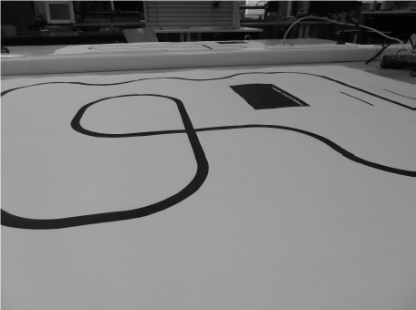

# LineFollower

lege repository die je als template kan gebruiken om een eigen repository te starten voor uw linefollower project

  
## specifications

microcontroller: Arduino NANO ESP32

motors: N20 DC motor 6V

h-bridge: DRV8833

sensors: QTR-8A

batteries: 2x 18650 XTAR

wireless communication: WiFi

distance sensor - motors:

weight:

speed: 

